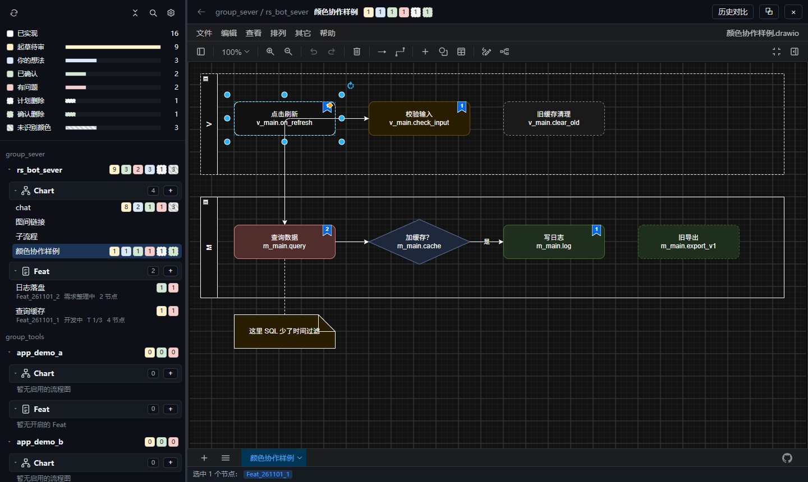
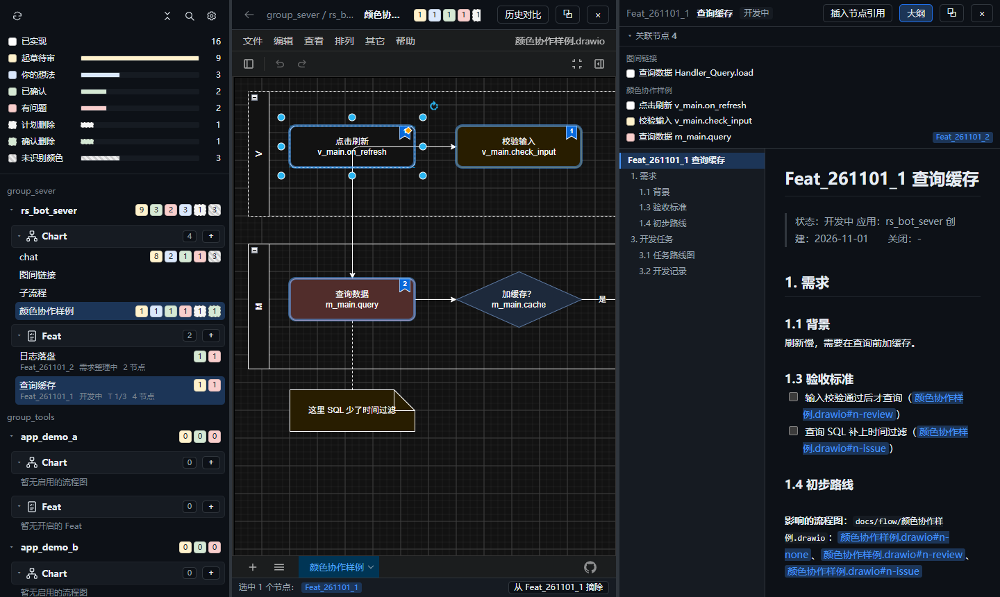
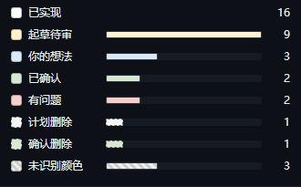
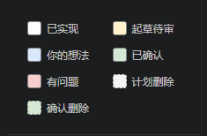

# Flow Coding

用流程图对齐方案，用 Feat 档案跟踪任务，让开发者与 AI Agent 围绕同一份文件协作。

Flow Coding（`flow_coding`）是一款本地桌面工具，按项目和 APP 汇总 draw.io 流程图与 Feat 需求档案。图里表达业务流程和协作状态，档案里记录需求、任务与验收；点击节点、标签或正文引用，即可在图与档案之间跳转。

[观看视频](#视频演示) · [查看功能](#功能一览) · [准备与运行](#准备与运行) · [Agent 加锁协作](#加锁协作)



## 功能一览

| 能力 | 使用方式 |
| --- | --- |
| 项目与 APP 总览 | 集中浏览流程图和 Feat，按名称、阶段或节点状态筛选；已关闭档案单独收纳。 |
| 颜色协作 | 用黄、蓝、绿、红及虚线标记方案、想法、确认、问题和删除计划，统计待处理节点。 |
| 图与 Feat 联动 | 节点挂接 Feat 标签，正文引用节点；点击书签、关联节点或引用即可双向定位。 |
| 文档与任务推进 | 实时编辑 Markdown，结合标题大纲、任务树、依赖与开发记录查看进展。 |
| 多页签与画布导航 | 图和档案可组合打开，页签支持拖动排序；缩略导航在普通模式与全屏下均可定位画布。 |
| 用户与 Agent 协作 | `flowctl` 加锁、查询节点与校验链接；Agent 解锁后界面同步最新文件，未查看更新逐级标绿。 |
| 历史与版本对比 | 内容变化时记录本机快照，按节点查看新增、删除、文字及状态变化，支持回滚。 |

### 图与需求并排查看

左侧选择 APP 和档案，中间审阅流程，右侧编辑需求；节点的 Feat 书签和正文引用把两边连接起来。



### 颜色状态与快速标记

总览统计帮助定位待处理内容；选中节点后，可直接从 draw.io 格式面板应用协作状态。

| 状态总览 | 节点状态色板 |
| :---: | :---: |
|  |  |

## 视频演示

**[观看约 3 分钟的配乐演示（MP4）](ui/guide/guide.mp4)** · [下载原视频](https://raw.githubusercontent.com/smallcat2333/rs_flow_coding/refs/heads/master/ui/guide/guide.mp4)

演示介绍项目浏览、颜色协作、Feat 联动、图间链接、加锁与历史。应用内也可通过侧栏顶部的「使用说明 → 视频介绍」观看，支持章节跳转与倍速播放。

截图和视频随仓库提供，素材位于 [`ui/guide/`](ui/guide/)，视频生成源码位于 [`scripts/guide_video/`](scripts/guide_video/)。

## 准备与运行

技术栈：Tauri 2 + Rust（rusqlite / roxmltree / notify）+ 原生 JS；编辑器为离线 draw.io webapp（embed 模式）；Markdown 编辑为 CodeMirror 6 + marked。

```bash
python scripts/fetch_drawio.py --proxy http://127.0.0.1:11809   # 下载并裁剪 draw.io 到 ui/drawio（约 56MB，不入库），并注入 flow_bridge.js
cd src-tauri && cargo run                                        # 启动 App
cargo build --release                                            # 发布版；flowctl.exe 同时产出
```

发布程序：`src-tauri\target\release\flow_coding.exe`。

Agent 通过 PATH 调用 `flowctl`：发布版编译后把 `src-tauri\target\release\flowctl.exe` 复制到 `%USERPROFILE%\.cargo\bin\`（已在用户 PATH）。

`ui/vendor/vendor.js`（CodeMirror + marked 打包结果）已入库；升级依赖时运行 `python scripts/build_vendor.py`（需要 Node，用 esbuild 打包 `scripts/vendor_entry.js`）。

首次启动点顶部齿轮 →「项目」→「项目目录」，在「增加路径」填入项目根目录（每行一个）并「保存并扫描」；新增 APP 时在此执行「全量扫描」。需要跳过的目录填入「排除路径」，每条必须位于某个增加路径内。侧栏「移除目录」会把目录加入排除路径，保留磁盘文件；恢复时删除对应排除项并重新扫描。顶部最左的刷新图标只读取已发现的目录；放大镜弹出悬浮搜索框。

单实例运行：再次双击 exe 只会把已打开的窗口调到前面。启动失败时弹窗显示错误原因。

## 文件约定

- 流程图：`<app>/docs/flow/<模块>.drawio`，未压缩 XML（App 内保存强制 `compressXml=false`）。
- Feat 档案：`<app>/docs/feat/Feat_YYMMDD_N_<名称>.md`。
- APP 识别：`docs/flow` 或 `docs/feat` 的上两级目录为 APP，APP 的父目录以 `group_` 开头时作为分组。
- 数据目录：`%APPDATA%\rs_flow_coding\`（`config.json`、`flow.db`、`locks\`）；项目更名后沿用，保留已有配置和历史，环境变量 `FLOW_CODING_HOME` 可覆盖。应用 ID 保持不变，已有页签和浏览器偏好继续使用。

## 节点颜色状态

| 颜色 | 识别（fillColor） | 状态 | 谁标记 | 之后变成 |
| --- | --- | --- | --- | --- |
| 无色 | 空 / `#FFFFFF` | 已实现 | - | - |
| 黄 | `#FFF2CC` | 起草待审 | Agent | 同意 → 绿；不同意 → 红 |
| 灰虚线 | `#F5F5F5` + `dashed=1` | 计划删除 | Agent | 同意 → 绿虚线；不同意 → 无色 |
| 红 | `#F8CECC` | 有问题（写在节点里或便签连到节点） | 用户 | Agent 修正后 → 黄 |
| 蓝 | `#DAE8FC` | 用户的想法或改动 | 用户 | 可行 → 黄；不可行 → 保持蓝 + 便签写原因 |
| 绿 | `#D5E8D4` | 已确认，下一轮执行 | 用户 | Agent 改完代码 → 无色 |
| 绿虚线 | `#D5E8D4` + `dashed=1` | 确认删除 | 用户 | Agent 删除节点与对应代码 |
| 其他 | 其他颜色 | 未识别 | - | 改成上表颜色 |

不计入统计：连线、便签（`shape=note`）、文本、泳道、分组。

选中节点后，draw.io 右侧格式面板的默认样式改为上表七个状态按钮（色块＋名称），点击同时设置填充色与虚线，支持多选，一次撤销；只选连线时保留原生样式。

## Feat 联动

- 左侧树每个 APP 分「流程图」「Feat」两组；Feat 第一行末尾只显示阶段标签，第二行显示编号、§3.1 任务进度（完成计入进度，暂缓与取消不计入执行任务总数）、挂接节点数及编辑锁提示。不显示流程图节点颜色统计或「可关闭」标签。阶段统一为探讨中、需求中、UI设计、开发中、待测试、测试中、待验收、已暂停、已关闭、已废弃、待明确。点「+」新建 Feat（编号 = 今天日期 + 当天序号）。
- Feat 正文采用实时 Markdown 编辑：编辑位置显示源码，其余区域显示排版效果，实时保存、加锁。左侧为标题大纲，右侧关联节点栏支持折叠、拖动调整宽度与独立滚动，窄栏通过顶部「关联节点」按钮展开。
- Feat 栏顶部「控件 / 文档」切换视图，默认控件页，记住上次选择。控件页左侧为档案头状态与竖向阶段导航（探讨 · 需求 · 原型 · 开发 · 测试 · 发布，每阶段一行摘要；当前阶段下列出章节，点击滚动到对应卡片，未填写的章节显示为灰色斜体；开发阶段常驻各 T 状态小标签，点击跳到路线图节点），打开时停在档案当前阶段，角标显示各阶段进度，有不通过或未闭环问题时标红；Feat 栏较窄时导航改为顶部横排。右侧内容铺满宽度，顶部按状态与统计给出下一步与可复制的 skill 命令。
  - 能直接写回原文的只有：§1.3 勾选、§4.2「结果 / 备注」列（OK / NG 按钮，再点一次清除；备注回车或失焦保存，竖线自动转义）、§4.3「复测：」段。其余章节只读：§0 / §2.1 探讨记录卡（待确认标黄）、§1.4 流程图节点标签（带节点颜色，点击定位）、§2.2 控件清单、§2.4 变更时间线、§3.1 依赖关系图（按实际宽度横向或纵向排布，同层任务自动换行，不出现图内横向滚动条；节点保留两行标题、悬停看全文并高亮前后依赖，跨层连线沿边缘绕行）、独立任务详情区（默认展示全部 T 的名称、状态和前置；点击节点或概览项展开完整详情，可返回全部任务；推进/确认命令只放在详情内）、§3.2 全部开发记录（选择 T 不再筛选记录）、§4.1 自测结果、§5 发布说明。档案头状态与 §3.1 状态只由 skill 写入。
  - §4.2 卡片获得焦点时：J / K 切换、1 OK、2 NG、N 进备注，Esc 放弃备注修改。每张卡片右上角可切到文档视图定位原文；推进树和节点跳转在控件页中定位到对应卡片。
  - 两个视图共用同一个编辑器文本，保存、加锁、撤销重做与磁盘同步一致；Agent 持锁时写入控件禁用。格式无法识别的小节（如 §4.2 缺「结果」列）显示原文并提示到文档视图修正。§2.5 截图为本地文件，暂只显示路径说明。
- Feat 档案 Ctrl+Z 撤销、Ctrl+Y 重做。撤销历史按档案独立，切换档案后清空；Agent 改动同步进来后不会被撤销。
- 关联方式：节点外层 `<object>` 上写 `tags="Feat_YYMMDD_N"`（可多个，空格分隔）。在流程图中选中节点，点底部常驻状态栏「挂到 Feat_xxx」或「从 Feat_xxx 摘除」。
- 打开 Feat：高亮同 APP 下挂了该编号的节点，「关联节点」列表按图分组，点击定位到节点。Feat 编号仅在各自 APP 内有效；跨 APP 同号标签不会高亮。点底部「挂到」时若 Feat 不属于当前图的 APP，悬浮提示只能挂到该 APP 的流程图，不写入标签；已挂上的残留标签仍可摘除。
- 单击节点主体只选中并更新底部信息；点击节点右上角蓝色书签才打开 Feat：挂了 1 个直接打开，挂了多个时弹列表选择，可按 Esc、点取消或点弹窗外关闭。打开后定位档案中引用该节点的位置。节点右上角蓝色书签显示挂接 Feat 数量（超过 9 显示 9+），角标不写入流程图文件。缺少本 APP 档案时，弹框按缺失编号提供「解除关联」，只摘除当前节点的对应标签并实时保存，其他标签保留；只读时禁用。
- 右键节点，菜单顶部有 Flow Coding 操作（右键空白或连线不显示），作用于当前选中的节点：
  - 「复制引用」：同底部栏按钮，复制 `图名.drawio#ID`，多选每行一个。
  - 「打开关联 Feat」：右键的节点挂了 Feat 才出现，行为同点书签。
  - 「挂到 Feat ▸」：列出本 APP 未收纳的 Feat，选中节点全部已挂的打勾；点击时全部已挂则摘除，否则补挂。不用先切换右侧当前 Feat；本 APP 没有进行中的 Feat 时该项置灰。
- 档案中用 `<图名>.drawio#<节点id>` 引用节点，预览里可点击跳转；「插入节点引用」把当前选中节点插入光标处。

## 挂载注释

- 注释角标在程序内打开置顶悬浮卡，可拖动标题栏，不阻止画布操作；卡片打开时，点选其他节点或连线直接切换注释，无注释时显示空状态。右上角「＋」添加注释，「×」关闭卡片；每条注释标题行右侧提供 11px 的「编辑 / 解绑 / 删除」按钮。仅焦点在注释内时 Esc 关闭卡片，焦点在画布或其他区域时不关闭注释。编辑中的正文在切换或关闭时保存，点「取消」放弃本次编辑。

## 节点 ID

- 节点的 `id` 是图内唯一身份，Feat 引用、图链接和历史对比都靠它；与 Agent 沟通节点统一写 `<图名>.drawio#<id>`。
- 每个节点左上角显示 ID 小卡（位于节点内，避免超出边界），超过 12 个字符省略，悬停看完整 ID；点小卡选中该节点。流程图顶栏「ID」按钮开关小卡，默认显示，偏好存本机 localStorage，主窗口与独立窗口同步。小卡只存在于视图，不写入文件。
- 选中节点后，底部栏显示 ID（多选显示前 3 个），点「复制引用」复制 `图名.drawio#ID`，多选每行一个，可直接粘到 Agent 会话。
- 流程图顶栏「复制路径」复制当前图的绝对路径，Feat 顶栏同名按钮复制当前档案的绝对路径，可直接发给 Agent 继续处理。未打开对应文件时按钮禁用。
- 流程图顶栏「定位节点」输入框：输入 ID（可带 `#`）定位当前图节点；或粘贴含 `图名.drawio#ID` 的文字（取第一个引用，可带目录，前后有其他文字也行），回车跳到对应图并选中，跨图跳转可用「返回上一张图」回来。图名先在当前 APP 查找，再在全部 APP 中找唯一同名；找不到图或节点时顶栏提示。
- 在 Flow Coding 内新建、复制、粘贴的节点和连线使用短号 `n1`、`n2`…（取图内 `n` 号最大值 + 1，同一张图内删除的号不再复用），取代 draw.io 默认的随机长 ID；已有 ID 不改。draw.io「编辑数据」（Ctrl+M）仍可修改 ID，修改会断开已有引用和链接，不建议改。

## 图间链接

- 每张图一个独立文件、一页，不区分特殊总图和模块图；任意节点可以同时挂多个 Feat 标签和一个图链接。
- 在 draw.io 选中节点，右键「编辑链接」，填 `子流程.drawio` 或 `子流程.drawio#节点id`。路径相对当前图的目录，跨 APP 用 `../` 相对路径；中文、空格及 URL 编码均支持。
- 带图链接的节点显示箭头角标，点击角标或原生链接打开目标图，可定位目标节点。Feat 书签与图链接角标并排，仍各自打开对应内容；角标只存在于视图，不写入 XML，也不改变节点状态颜色。
- 流程图顶栏「返回上一张图」逐层返回来源图并选中来源节点，切换前等待自动保存完成。目标图或节点不存在时提示错误，保留当前图。
- 在 Flow Coding 内重命名图时，同步当前目录及已配置项目里的图间链接，保留节点锚点；关联图持锁时拒绝整次改名，不留下半套引用。外部手动改名不会自动修复引用。
- `flowctl links <图文件或目录>...` 校验直接图链接并输出 JSON（源图、源节点、链接、原因），不递归展开，因此循环引用合法；0 = 通过，3 = 坏链接或源 XML 不可读，1 = 命令参数/路径错误。网页和非图文件链接不参与图链接校验，现有 `flowctl check` 语义不变。

## 状态与收纳

- Chart 与 Feat 分组使用图标、加粗标题和数量徽标。开启/启用条目不额外显示状态，关闭/废弃/停用条目灰显；右键条目打开状态菜单（也支持 Shift+F10），Chart 停用后收纳，可重新启用；收纳的 Feat 可重新开启，恢复时选择需求、开发或测试阶段。
- Chart 与 Feat 条目右键菜单支持「复制名称」（完整文件名，含扩展名）和「复制路径」（绝对文件路径）；复制不切换当前文件，也不改变状态。
- Feat 以 Markdown 档案头的「状态」和「关闭」日期为真源：`已关闭`、`已废弃`进入收纳区；开发完成、测试完成不会自动关闭。Feat 的「关闭 / 废弃」不在 App 内写文件：菜单弹窗显示未完成任务、非无色节点数量和对应命令（`/smallcat-feat-5-close <编号>`、`/smallcat-feat-drop <编号> <原因>`），复制到 Agent 会话执行，由 skill 同步发布说明、CHANGELOG、README 并提交；后端也拒绝直接写「已关闭」「已废弃」。
- Chart 停用信息保存在各 APP 的 `docs/flow/.flow-coding.json`，按含扩展名的文件名记录 `status: "disabled"` 与 RFC3339 `disabled_at`；未记录的图默认启用，重新启用移除对应记录。此文件随项目 Git 同步。
- 收纳保留文件原路径及节点标签。关闭 Feat 不会停用关联图；停用 Chart 不再计入 APP 与顶部待办，原图、历史快照及 Feat 关联仍保留，可继续查看。
- 收纳区默认折叠，展开后 Chart 按停用年份分组，Feat 按关闭月份分组（如 2026-11）。月份行右侧显示该月数量，可再折叠，默认展开，折叠记在本机侧栏偏好；搜索时月份强制展开。分层模式每组先显示 5 项、每次追加 5 项，平铺模式先显示 20 项、每次追加 20 项；收起月份、收纳区、Chart / Feat、APP 或分组后，内部列表重新从 5 项开始。搜索默认匹配活跃项，勾选「搜索含历史」可查收纳内容。
- 侧栏折叠、收纳区展开及历史筛选偏好写入本机 `%APPDATA%\rs_flow_coding\config.json` 的 `sidebar`；搜索词不持久化。SQLite `flow.db` 继续保存本机图历史和统计。
- 状态变更遵守编辑锁；Feat 在确认期间内容变化会拒绝覆盖，停止编辑后刷新重试。元数据损坏直接提示错误，不会静默视为全部启用。

## 窗口、主题与大纲

- 画布右下角固定显示约 200×140px 的原生缩略导航，以蓝色矩形标出当前可视区域；点击缩略图或拖动蓝框定位主画布。缩略图随缩放、滚动及分栏尺寸更新，避开图形库、格式面板和滚动条；全屏、Agent 持锁只读时仍可导航，不修改流程图内容。

- 点流程图栏右上角全屏按钮，当前屏幕只展示流程图画布，隐藏外层顶栏、侧栏及 draw.io 菜单、图形库、格式面板，临时禁用编辑；保持当前缩放比例与画布中心，直接扩展当前视图。按 Esc / F11 退出时，恢复窗口与选中节点，继续保持全屏内最后浏览的位置和缩放比例。
- 侧栏「布局」提供左右、上下两种排布；流程图与 Feat 正文可同时显示，拖动标题栏交换位置，或切成可移动、可调整大小的悬浮栏，支持恢复默认排布。
- Feat 右侧栏上为关联节点、下为推进树，默认高度 1:3，拖动中间分隔条调整、双击恢复。关联节点一个节点一行，放不下时省略，悬停查看编号、完整名称和其他标签。顶栏「关联节点」「推进」按钮或区头可分别收起，推进默认展开。推进树自上而下列出需求、UI、开发、测试、关闭五个阶段，开发阶段下挂 T、T 下挂子 T。每个 T 固定两行：第一行编号与任务名（超长省略），第二行状态、子任务进度、开发记录日期与依赖（前置 T 已完成为绿、未完成为黄，放不下时截断）；完整任务名、状态与依赖原文在悬停提示中显示，依赖支持「T1～T7」区间；悬停 T 高亮其前置与后续，点依赖跳到对应 T，点阶段或任务定位到档案对应行。只读汇总档案，不直接改状态。
- 主窗口顶部为页签栏：一个页签可以只有一张图、只有一个 Feat，或图 + Feat 组合。侧栏再点已经打开的图或 Feat，直接跳到已有页签；未打开时，普通点击替换当前页签里的同类内容，Ctrl+点击在右侧新开页签。页签可拖动排序。页签前缀用与侧栏 Chart / Feat 相同的图标区分类型；点栏内 × 关掉其中一类。点「＋」新建空白页签，之后点的内容填进新页签；点页签切换（图会重新载入），× 或中键关闭页签，全部关完保留一个空白页签。页签列表与当前页签存本机，重启恢复，已删除的文件不再恢复；同一页签内的图跳转可返回，切页签后回退清空。独立窗口不显示页签。
- 大纲、关联节点、推进、复制路径及窗口操作使用统一图标按钮（30×28px，图标 16×16px），悬停显示用途；关闭叉号为七成不透明红色。Feat 正文拖选范围在深浅主题、聚焦和失焦时均保留蓝色高亮。
- 设置 →「链接与页签」可控制跨 APP 自动新建页签，默认开启；同一 APP 仍复用当前页签，目标已打开则跳到已有页签。
- 顶部页签与侧栏共用绿色未查看更新提示：组合页签中的流程图或 Feat 任一有未查看更新即标绿，查看后同步清除，刷新后保留；已停用流程图和已收纳 Feat 不触发提醒。
- 点流程图栏或 Feat 栏右上角「⧉」弹为独立窗口；每类最多一个，之后在主窗口树中点同类文件会切换到对应独立窗口。独立窗口右上角「回到主窗口」保存并关闭独立窗口，在主窗口继续打开同一文件（图保持选中节点，Feat 保持阅读位置）；直接关闭独立窗口后，再点树也恢复在主窗口打开。弹出成功后清理来源页签：组合页签保留另一类内容，已经为空的来源页签关闭；最后一个来源页签也为空时，顶部只保留「＋」，该状态重启后仍保留。打开方式按类别记在本机：上次用独立窗口打开的，重启后仍在独立窗口打开。关闭主窗口会退出整个应用。
- 两个窗口之间仍可点关联节点定位、点书签打开 Feat、插入选中节点引用；流程图高亮跟随当前 Feat。
- 拖动左侧树右边界调整宽度（200–640px），下次打开保留；双击边界恢复默认宽度。
- 顶部齿轮打开设置，在「外观」中选择跟随系统、浅色或深色；覆盖树、Markdown 与 draw.io，立即保存，独立窗口同步主题。
- Feat 内容区左侧显示 1–4 级标题大纲，点标题定位源码与预览，滚动正文时大纲跟随；点「大纲」可收起，正文与大纲分别滚动。
- 节点信息与挂/摘按钮固定在流程图底部，选中/取消节点不会改变编辑区高度。

## 加锁协作

- App 内每次改动立即写盘（无未保存状态），首次改动加用户锁，停止编辑 3 秒释放；用户锁 60 秒无心跳失效。流程图与 Feat 档案同口径。
- Agent 改图或改 Feat 档案必须：

```bash
flowctl lock <file> --wait 30
```

  编辑文件后：

```bash
flowctl unlock <file>
```

  `lock` 被用户持有时等待至超时，失败退出码 2；`.drawio` 的 `unlock` 先校验 XML，损坏时不释放锁。Agent 锁 10 分钟失效。
- Agent 持锁期间 App 转只读：流程图禁止编辑、Feat 正文不可修改，但画布仍可缩放、滚动查看，正文可滚动、选中复制，内容不变暗，内容区底部显示半透明悬浮只读标识，不占用布局且鼠标穿透；释放后自动合并磁盘最新内容，不需要重新打开。当前 Feat 及侧栏已标锁条目每 1.5 秒巡检，解锁或超时后自动清除「Agent 编辑中」，不依赖文件变更通知。
- 其他命令：`flowctl status <file>`、`flowctl stats <file|dir>...`、`flowctl nodes <file> [--status review]`、`flowctl new <dir> <name>`。
- Feat 命令：`flowctl feat <feat.md> [--status s]` 列出同 APP 流程图中挂了该编号的节点；`flowctl check <feat.md>` 为关闭门槛，挂接节点全部无色退出码 0，没有挂接节点或仍有非无色节点退出码 3。

## 设置、统计与数据维护

- 保存、复制、目录操作、节点定位及设置异常统一使用窗口底部的半透明悬浮状态，6 秒后收起，不挤占标题栏或内容区，也不拦截鼠标；设置对话框内同样可见。需要用户选择的确认、输入与列表对话框保持原有交互。
- 顶部一行依次为刷新、侧栏排布、全部展开/收纳、分隔线、搜索、排布方式、使用说明、设置。排布方式弹层仅保留「左右／上下」，移除恢复默认和附加说明；弹层限制在侧栏宽度内，窄侧栏不越出窗口。设置弹层无外边框，左侧为分类树（常规：外观、侧栏、内容更新；项目：项目目录；数据维护：数据库、目录缓存），右侧为对应内容，支持方向键、Home/End、Enter 操作。
- 顶部的书本图标打开使用说明：「图文说明」按章节介绍颜色协作、统计、Feat、图间链接、加锁与历史；「视频介绍」播放约 3 分钟的动画介绍（含配乐），视频下方可按章节跳转并选择倍速，关闭弹层或切回图文时暂停。视频与配图在 `ui/guide/`，由 `scripts/guide_video/render.mjs` 配合 `timeline.mjs`、`scene.mjs`、`music.mjs` 重新生成（需 `puppeteer-core`、`ffmpeg-static`、`three` 与本机 Chrome）。
- 左上按状态逐行显示色块、名称、数量条和节点数，只汇总启用的流程图；顺序为已实现、起草待审、你的想法、已确认、有问题、计划删除、确认删除、未识别颜色。「已实现」只显示数量；其余状态以其中最大值为满格，零值不填充，悬停分条说明该状态的颜色、线型、详细意义和下一步操作，同时保留数量、占全部节点的比例及点击过滤提示。
- 分层与平铺模式的 Chart 均分两行：第一行图名与状态数量，第二行来源 APP；Chart 与 Feat 的编辑状态提示统一放到第二行右端。
- 画布和侧栏条目右键菜单共用内置 SVG 线条图标，覆盖复制、删除、剪切、锁定、图层顺序、样式、链接和 Feat 等操作；图标随深浅主题变色，保留 draw.io 原有图标与勾选标记。
- 左上状态统计行可点击单选过滤：选中高亮，只显示包含该状态节点的启用流程图；再次点击同一行取消，点击另一状态切换。无匹配图的 APP/分组隐藏，过滤期间只显示 Chart，取消后恢复 Feat 列表。选中状态使用圆角浅色底与细描边。可与名称搜索叠加；统计仍为全局启用图的数量，过滤不持久化、不改变文件状态或当前打开的图。过滤时临时展开结果，取消后恢复原折叠偏好。
- 展开/收纳为单个按钮：有折叠项时点击全部展开（含历史分组），否则全部收纳，图标随状态切换。只修改本机显示偏好，清除当前搜索，保留每批 5 项的加载方式。
- 放大镜弹出悬浮搜索框（名称、Feat 编号、状态，可勾选「搜索含历史」）；点框外收起但保留筛选，放大镜高亮提示；Esc 清空并收起。
- 分组与 APP 一样支持双击名称原位修改本机显示名，灰色小字保留原目录名，清空或填回原名恢复默认；别名以分组目录路径为键。
- Chart / Feat 条目右键「置顶 / 取消置顶」：置顶项在侧栏顶部独立区域显示，原位置仍保留；分层、平铺模式共用置顶记录，不受目录折叠与分页影响。点击任一副本打开同一文件，取消置顶只移除顶部副本；置顶记录保存在本机侧栏配置，重启恢复，程序内改名跟随新路径。
- 分组与 APP 可上下拖动排序（APP 只在所属分组内移动），顺序写入本机偏好。
- 「设置 → 侧栏 → 更新自动置顶」默认开启：Agent 或外部改动流程图/Feat 时，该条目移到所在 Chart/Feat 列表最上，所属 APP 和分组也移到最上，未查看的条目、Chart / Feat 区头、APP 与所属分组逐级显示淡绿色底色，点开条目后同步清除；在 App 内自己编辑（持用户锁写盘）不触发。关闭后保持现有顺序，不再新增置顶与标记。置顶时间与未查看标记保存在本机配置，文件删除或改名后刷新时清理。
- 「设置 → 内容更新」提供两个默认勾选项：图内容更新时维持原有缩放与位置、Feat 内容更新时保留原位置；取消后分别自动适应图视图、回到档案文首。用于当前文件的外部更新及 Agent 解锁同步，首次打开文件和主动节点跳转保持原有行为。偏好与主题一样保存在本机 localStorage，主窗口与独立窗口共享。
- 数据维护显示 `flow.db`（含 WAL/SHM）大小、流程图登记数、快照数、可清理旧快照数和节点记录数。确认清理后，每张图只保留最新快照，删除旧快照及对应节点记录，并回收数据库空间；删除的旧历史无法恢复，项目文件不受影响。
- 缓存统计和清理范围是 `config.json` 的 `flow_dirs` 目录扫描缓存，显示缓存目录数及序列化内容大小；清空后下次刷新自动重新扫描，项目根、APP 别名、侧栏偏好和编辑锁保留。

## 历史

每次写盘（用户保存、Agent unlock、外部改动、扫描）内容变化即记一条快照，同内容不重复。历史面板勾选两个快照对比：按节点 id 列出新增、删除、文字变化、状态变化（如 黄 → 绿）；可只读查看旧版或回滚（回滚本身也是一条快照）。

流程图编辑区底部常驻时间线：每个快照一个圆点，按来源着色（你 / Agent / 回滚 / 其他），悬停看时间与来源；每天第一版上方标注日期（今年只写月/日，往年带年份，今天高亮），过密时自动省略。滑块左侧为流动发光的进度条，滑块之后的版本变淡，回看中滑块呼吸闪烁；系统开启「减少动态效果」时停止动画。拖动滑块到旧版本时，编辑区上方盖一层只读预览，沿用当前缩放和位置，顶部显示该版时间戳与来源，并按与上一版的差异给新增节点描绿边、变化节点描黄边；时间线旁显示新增、变化、删除数。拖回最右端、点「回到当前」或按 Esc 收起预览，正在编辑的图、自动保存与锁都不受影响。时间线只读本机快照，「数据维护 → 清理旧快照」后只剩最新一版；全屏时隐藏。

## 开发

```bash
cd src-tauri && cargo test --lib                         # 单元测试
python scripts/dev_server.py --samples tests/samples     # 浏览器预览（注入 Tauri 模拟层）
```

APP 文件夹行：双击名称直接原位编辑本机显示名，Enter 或失焦保存，Esc 取消；清空或填回原名恢复默认。灰色小字保留原目录名，宽度不足时省略。整行不换行，优先显示起草待审、待 Agent 实现（绿色确认与确认删除合计）、有问题的非零统计，其他非零状态按剩余宽度显示，数量为 0 的色块隐藏。Chart / Feat 数量为 0 时不显示空标题和占位区，已有收纳内容仍可展开查看。单击 APP 行任意位置（含名称）折叠/展开，名称单击会稍等片刻以区分双击改名；磁盘目录与引用路径保持原样。

## 变更记录

2026-11-04 | 0.2.2 | 任务路线图跨层线束按 4px 中心距并排分道，接入与转出同步错位，高亮线间仍留 1.6px 空隙；边缘通道最多并排三条，超出后允许重叠复用

2026-11-04 | 0.2.2 | 任务路线图跨层依赖改用贝塞尔圆角绕线，纵向图共用左侧通道、横向图共用上侧通道，保留相邻层曲线和依赖箭头

2026-11-04 | 0.2.2 | 删除状态节点统一绘制灰白斜线，确认删除同时保留绿色底色，适配深浅主题及 SVG 导出，不改图文件中的状态标记

2026-11-04 | 0.2.2 | 注释操作按钮移到每条标题行右侧，字号缩为 11px，简化为编辑、解绑、删除；Esc 仅在焦点位于注释内时关闭注释；页签四色标记改为整块底色，移除前置色点及色盘选中外圈，绿色更新提示优先

2026-11-04 | 0.2.2 | 顶部页签增加闲置存活时间设置（小时，0 表示不自动关闭），记录用户操作时间并在启动、恢复焦点和每分钟检查到期关闭；页签固定 200px 宽，隐藏滚动条，滚轮切换；右键提供蓝、紫、橙、红四色点及清除标记，绿色保留给未读更新

2026-11-04 | 0.2.2 | 节点与连线注释浮层改为半透明毛玻璃，背景不透明度 45%、模糊 16px，适配深浅主题并保持正文清晰

2026-11-04 | 0.2.2 | 时间线改为圆点刻度与流动发光进度条，上方按天标注日期，回看中滑块呼吸提示

2026-11-04 | 0.2.2 | 流程图底部新增历史时间线，拖动按快照逐版只读回看图的搭建过程，高亮相对上一版的新增与变化节点

2026-11-04 | 0.2.2 | 本地项目目录、Rust 包、库和主程序更名为 flow_coding，生成 flow_coding.exe；沿用应用 ID 与数据目录，保留配置、历史和页签

2026-11-04 | 0.2.2 | Chart / Feat 右键手动置顶，侧栏顶部独立区域显示副本，原位置保留，置顶记录持久化

2026-11-03 | 0.2.2 | 重做任务详情：默认显示全部 T 概览，选中后在开发记录上方显示独立详情，记录保持完整；依赖图按容器宽度重排、跨层连线绕行，窄栏导航让出空间，移除图内横向滚动条

2026-11-03 | 0.2.2 | 侧栏平铺模式每批显示 20 项，分层模式仍为每批 5 项，切换模式重置分页

2026-11-03 | 0.2.2 | 节点左上角 ID 小卡底色与边框改为 65% 不透明度，文字保持清晰

2026-11-04 | 0.2.2 | 设置增加“强制拆分”（默认关闭）：单独打开流程图或 Feat 时占满主区，开启后给另一侧保留空位；区分实际打开内容与首页提示，修复单独打开 Feat 时残留空白图栏

2026-11-04 | 0.2.2 | 修复切图及全屏闪烁、纯 Feat 切回图时载入遮罩残留和长图偏边：冻结旧画面，等两栏与绘制稳定后按最终视口适应居中，保留用户缩放与节点定位

2026-11-03 | 0.2.2 | 全屏直接展开当前画布视图，保持缩放和中心位置；退出后保留全屏内最后浏览的位置与比例

2026-11-03 | 0.2.2 | 只读状态改为半透明悬浮标识；保存、复制、节点定位及设置异常统一悬浮提示，鼠标穿透且不占布局

2026-11-03 | 0.2.2 | Feat 控件页导航收窄并在当前阶段下列出章节可点跳转、开发阶段显示 T 状态概览；§3.1 路线图改为依赖关系图；右侧推进树每个 T 固定两行，详情移入悬停提示，依赖支持「T1～T7」区间

2026-11-03 | 0.2.2 | Feat 控件页阶段页签改为左侧竖向导航（状态徽标、应用 / 创建 / 关闭与阶段摘要），内容区铺满宽度，§1.1 背景与 §1.2 目标改为上下排列

2026-11-03 | 0.2.2 | Agent 只读提示改为内容区底部半透明悬浮标识，不占布局且鼠标穿透，流程图与 Feat 共用

2026-11-03 | 0.2.2 | Feat 栏新增控件页：按阶段分页显示专用控件，§4.2 OK / NG 与备注、§1.3 勾选、§4.3 复测直接写回原文，其余章节按卡片、时间线、状态色块只读展示，并给出下一步 skill 命令；与文档视图共用同一文本

2026-11-03 | 0.2.2 | 重写项目首页介绍，补充功能概览、四张界面配图与演示视频观看、下载入口

2026-11-03 | 0.2.2 | 画布右下角增加原生缩略导航，标示当前可视区域，支持点击与拖动定位，普通模式和全屏均可用

2026-11-03 | 0.2.2 | 项目目录支持增加路径与排除路径；侧栏移除目录改为加入排除路径，保留磁盘文件

2026-11-03 | 0.2.2 | 弹出独立窗口成功后清理来源空页签，最后一个空页签移除后只保留新增按钮

2026-11-03 | 0.2.2 | 侧栏首次显示 5 项，每次追加 5 项；收起月份、收纳区或上级分组后重置内部列表分页

2026-11-03 | 0.2.2 | Feat 第一行末尾只显示统一阶段标签，移除可关闭和节点颜色统计；工具栏改统一图标，关闭叉号为七成不透明红色

2026-11-03 | 0.2.2 | 修复 Feat 源码行背景遮挡复制选区，聚焦与失焦均显示选区高亮

2026-11-03 | 0.2.2 | 注释卡右上角＋添加、×或 Esc 关闭并保存草稿，移除底部按钮栏；跨 APP 打开默认新建页签并可在设置关闭

2026-11-03 | 0.2.2 | 顶部页签与侧栏同步绿色未查看提示，组合页签任一文件更新即提示，查看后清除

2026-11-03 | 0.2.2 | 已收纳 Feat 的月份行显示数量，并可单独折叠

2026-11-03 | 0.2.2 | 已收纳 Feat 按关闭月份分组，时间小字显示为 2026-11 这种年月

2026-11-03 | 0.2.2 | 流程图与 Feat 顶栏增加「复制路径」，复制当前文件的绝对路径

2026-11-03 | 0.2.2 | 页签可拖动排序，侧栏点击已打开内容跳到已有页签；关联节点单行省略并悬停显示全文；未查看绿色从分组、APP、Chart/Feat 区头逐级传到具体条目

2026-11-03 | 0.2.2 | 跨 APP 挂接不再在底部状态栏预告，点「挂到」不可行时弹框拒绝

2026-11-03 | 0.2.2 | 挂载注释改为程序内置顶悬浮卡，可拖动且不阻断画布操作，随选中节点或连线切换内容

2026-11-03 | 0.2.2 | 侧栏 Ctrl+点击在新页签打开；页签前缀改为 Chart / Feat 图标；Agent 持锁只读时可缩放滚动查看，去掉变暗遮罩改为栏顶提示条；侧栏分组与 APP 行同尺寸，Chart / Feat 区头缩小一级

2026-11-03 | 0.2.2 | 主窗口顶部页签（单图 / 单 Feat / 图 + Feat，＋ 新建空白页、重启恢复）；独立窗口增加「回到主窗口」并记住打开方式；修复图载入中关闭流程图后无法再打开图

2026-11-03 | 0.2.2 | 推进矩阵改为 Feat 右侧栏下方的推进树（与关联节点 1:3，可拖动）：阶段主干挂 T 与子 T，显示依赖、状态和开发日期；移除独立矩阵栏与左+右上下排布

2026-11-03 | 0.2.2 | 侧栏更新未查看提示改为绿色底色，浅色与深色主题均与蓝色选中项区分

2026-11-03 | 0.2.2 | 右侧状态色板增加当前协作状态文字与颜色块，多选不同状态显示混合状态

2026-11-03 | 0.2.2 | 使用说明视频更新为约 3 分钟配乐版，播放器支持章节跳转与倍速
2026-11-03 | 0.2.2 | Feat 推进矩阵与三栏布局：阶段和 T/子 T 定位、拖动换位、悬浮与排布恢复；任务统计排除暂缓和取消
2026-11-03 | 0.2.2 | Feat 实时 Markdown 编辑与右侧独立关联节点栏；侧栏支持平铺并显示来源 APP
2026-11-03 | 0.2.2 | 修复 Agent 解锁后侧栏标签残留；全屏改为仅展示流程图画布，Esc 恢复编辑视图
2026-11-03 | 0.2.2 | 流程图顶栏新增全屏按钮（历史对比右侧），点击全屏展示当前图，Esc 退出
2026-11-03 | 0.2.2 | 节点右键菜单增加复制引用、打开关联 Feat、挂到 Feat（本 APP 未收纳 Feat 子菜单）
2026-11-03 | 0.2.2 | 节点左上角常显 ID 小卡，顶栏 ID 按钮开关并记忆偏好

2026-11-02 | 0.2.2 | 节点 ID：底部栏显示并复制「图名.drawio#ID」引用，顶栏按 ID 或粘贴引用定位节点（可跨图），新建节点改用短号 n1、n2…

2026-11-02 | 0.2.2 | 侧栏顶部新增书本图标，打开图文使用说明与视频介绍

2026-11-02 | 0.2.2 | draw.io 格式面板默认样式改为七个协作状态按钮，颜色与虚线一次设置并可撤销

2026-11-02 | 0.2.2 | 设置新增默认勾选的图更新保留缩放与位置、Feat 更新保留阅读位置；取消后自动适应图视图或回到档案文首

2026-11-02 | 0.2.2 | 左上状态统计支持点击高亮并过滤流程图，再点取消，可叠加名称搜索

2026-11-02 | 0.2.2 | 复制成功提示改为随主题适配的绿色，失败提示保留红色

2026-11-02 | 0.2.2 | Chart/Feat 右键菜单增加复制名称与复制绝对路径，保留原有状态操作

2026-11-02 | 0.2.2 | 修复普通节点选中误打开 Feat：分离选中通知与书签打开事件，仅点击书签才打开关联档案

2026-11-02 | 0.2.2 | 任意节点的图链接角标与指定节点跳转、逐层返回；图改名同步项目内图链接；flowctl links 检查目标文件和节点

2026-11-02 | 0.2.2 | 缺失 Feat 档案弹框支持按编号解除当前节点关联，保留其他标签，只读时禁用

2026-11-02 | 0.2.2 | 单击 APP 名称也可折叠/展开，双击仍为原位改名

2026-11-02 | 0.2.2 | 侧栏顶部改为刷新居左与单个展开/收纳按钮、悬浮搜索，去掉标题与待办汇总；统计条重排且「已实现」只计数；设置弹层去边框并改为左侧分类树；分组支持显示别名；分组/APP 拖动排序；更新自动置顶与淡蓝未查看标记
2026-11-02 | 0.2.2 | 顶部设置/刷新/搜索图标入口，设置集中外观与项目目录；新增本机数据库和目录缓存统计/清理、逐状态数量条、全部展开与全部收纳

2026-10-30 | 0.1.0 | 首版：APP 汇总与颜色统计、draw.io 内嵌实时编辑、用户/Agent 加锁、SQLite 历史快照与对比、flowctl CLI
2026-11-02 | 0.2.0 | Feat 联动：树分流程图/Feat 两组、Feat Markdown 实时编辑与加锁、流程图与 Feat 分栏、节点 tags 关联与多 Feat 选择、flowctl feat/check
2026-11-02 | 0.2.1 | 单实例运行（重复启动激活已有窗口）、启动失败弹窗；Feat 档案 Ctrl+Z / Ctrl+Y 撤销重做
2026-11-02 | 0.2.2 | 流程图/Feat 独立窗口与跨窗口联动、侧栏宽度拖动记忆、全界面深色主题、底部常驻节点栏、同 APP 标签关联校验、节点书签计数、多 Feat 选择 Esc 取消、Feat 标题大纲与滚动定位
2026-11-02 | 0.2.2 | Feat 开启/关闭/废弃、Chart 启用/停用、按年份折叠收纳、历史搜索与分批显示；项目状态与本机侧栏偏好分开持久化，启用图参与日常待办统计
2026-11-02 | 0.2.2 | 侧栏状态操作改为条目右键菜单，移除行尾三个点和开启标识，收纳条目灰显；Chart/Feat 增加分组图标、加粗标题和数量徽标
2026-11-02 | 0.2.2 | APP 文件夹支持本机显示别名、灰色小字原目录名、重启记忆和清空恢复；名称双击编辑与小三角折叠分开处理
2026-11-02 | 0.2.2 | Feat 关闭/废弃改为弹窗提示并复制 skill 命令，后端拒绝直接写归档状态；README 补充 flowctl 安装位置
2026-11-02 | 0.2.2 | APP 名称改为原位编辑，移除改名提示 tooltip；目录行保持单行并优先显示待审、待实现、有问题统计，其余状态按宽度显示
