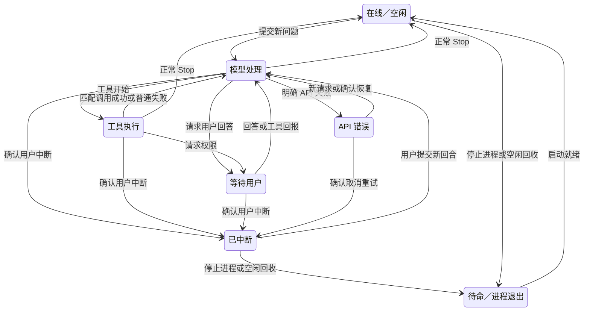

# Fix_261106_5 中断后仍显示执行中

> 状态：定位中
> 应用：flow_coding
> 创建：2026-11-06　　关闭：-

## 1. 现象
### 1.1 问题描述
用户在 Claude Code TUI 按 Esc 后，终端出现 `Interrupted · What should Claude do instead?`，但 Flow Coding 仍显示 Bash 执行中和运转图标。用户要求梳理 TUI 与图标的完整状态机。

### 1.2 复现步骤
1. CLI 回合进入 Bash 工具执行。
2. 按 Esc，观察 TUI 明确显示 Interrupted。
3. 会话列表及活动轨道仍显示 Bash 执行中（用户截图，CLI v2.1.318）。

### 1.3 影响范围
会话列表、页签、主窗口机器人、总览、右侧信息栏，以及依赖回合状态的协作投递。进程存活与当前回合执行需要分开。

## 2. 根因分析
- 当前只注册 PostToolUse，没有 PostToolUseFailure；正常 Stop 才清理 tool。
- 官方明确 Stop 不因用户中断触发；取消运行中的工具也不保证触发 PostToolUseFailure，不能仅补注册该 Hook。
- Esc 输入当前只转发 PTY，PTY 输出解析当前仅识别 API 错误，没有消费明确的 Interrupted 输出。
- 用户已提供稳定现象；正在以实际 CLI 记录和可控终端复现核对状态转换，不向真实模型发送请求。
- 已检查本项目及各级父目录，无 CodeGraph 索引，使用真实源码检索；docs/flow 下无现有业务图，本次状态机分析记在本档案。

- 真实记录核对：截图会话在 2026-11-06 21:28:28（本地时间）写入顶层 user 消息 `[Request interrupted by user for tool use]`，与截图 Interrupted 一致；其后 21:29:50 才开始下一轮 Bash 调用。仅提取事件种类及工具 ID，未输出业务提示或工具结果正文。

**根因**：进程存活、回合执行与工具执行被混用；中断路径不触发正常 Stop，当前又未处理明确中断输出和失败/拒绝工具的结束路径，因此残留 tool 使图标长期保持执行状态。
**确信度**：已定位到根本原因；正在用离线真实 ConPTY 复现和验证。

### 状态契约
| 层面 | 信号 | 应有状态与边界 |
| --- | --- | --- |
| 进程 | ConPTY 子进程存在 / 退出 | 在线 / 待命或异常退出；在线不代表正在工作 |
| 回合开始 | UserPromptSubmit | 运行中，建立新回合并清掉旧工具和中断标记 |
| 工具开始 | PreToolUse | 按 tool_use_id 记录在途调用；并行工具分别结束 |
| 等待用户 | PermissionRequest / permission_prompt / AskUserQuestion | 等你确认或等待回答；不能显示正常运转 |
| 工具成功 | PostToolUse | 仅结束对应工具，回到模型处理；不代表本轮完成 |
| 工具失败/自动拒绝 | PostToolUseFailure / PermissionDenied | 清对应工具，允许模型处理失败；不直接当回合成功或最终 API 错误 |
| 用户中断 | 与本次 Esc/Ctrl+C 对应的明确 Interrupted 输出，或 is_interrupt=true | 已中断；进程保留，工具停止显示，不标完成、不自动投递协作任务 |
| 普通 Esc | 菜单关闭、编辑模式切换，无中断证据 | 状态不变，按键本身不判定结束 |
| API 重试/最终失败 | 明确 API 报错 / StopFailure | API 错误；进程可继续存在，不标完成 |
| 正常完成 | Stop | 空闲，才记完成并处理正常完成后的协作队列 |
| 长时间无事件 | 前端心跳显示 | 仅疑似等待提示，不得据此判为完成、中断或 API 错误 |
| 子代理 | 子代理自己的事件 | 不得覆盖主会话的中断或错误状态 |

注意：官方文档说明 PermissionDenied 只覆盖 auto 模式拒绝，不覆盖手工拒绝或 Esc；PostToolUseFailure 也不覆盖所有运行中工具取消，所以不能用它们替代 TUI 的明确中断证据。

## 3. 修复方案
- `agent_state.rs` 集中实现中断和工具转换；用 tool_use_id 记录并行在途工具，仅结束匹配调用，迟到结果不跨回合清工具。
- `agent.rs` 接入 PostToolUseFailure、PermissionRequest 与 PermissionDenied；询问问题和权限确认进入 wait，普通失败回到模型处理，不当正常完成。
- Esc/Ctrl+C 输入只登记待确认请求；PTY 流在同一回合发现完整 `Interrupted · What should Claude do instead?` 后进入 interrupted。没有取消输入的历史输出不触发；新回合/新进程重置解析上下文。
- interrupted 清掉主工具、权限和 API 错误显示；不记 done、不投递排队协作任务，不推断未知子代理的终态。只有新 UserPromptSubmit 或 SessionStart 可离开中断状态，迟到主回合结束与子代理事件不能覆盖它。
- 列表、页签、总览和主窗口机器人显示「已中断」并停止运转语义；右侧耗时冻结在中断时刻。顶部进程计数改「在线」，避免把仍存活的 CLI 算作正在工作。
- 用户再次输入只刷新空闲回收计时；真正提交后才开始新回合。中断会话可按原空闲策略回收，但不自动接受协作投递。
- 不写 README，不提交。

### 状态图

进程在线是独立维度：图中 Idle、Run、Tool、Wait、Interrupted、Api 都可以保持同一 CLI 进程在线。普通 Esc 只有按键、没有确认证据时不触发状态转换。所有在线状态遇到进程真实退出都会转待命或异常退出；图中省略这些重复连线。

## 4. 验证记录
- 修复前复现：独立进程、隔离数据目录，真实 ConPTY + 假 CLI；UserPromptSubmit → PreToolUse(Bash) → 键盘 Esc → 明确 Interrupted 输出，无 Stop；旧实现仍 run+Bash，稳定复现（2026-11-06）。
- 修复后联调：同一真实 PTY/TCP 链路覆盖菜单 Esc、Bash 中断、思考中断、结构化 is_interrupt、历史输出、子代理与迟到工具回报、正常失败、权限请求/拒绝、AskUserQuestion、API 重试/最终失败和恢复，全部通过；未发送模型请求。
- 前端：新增中断显示、冻结耗时和主窗口机器人状态回归，初次全量 212 项通过；预览发现泳道新状态映射遗漏，已补映射及对应断言，待最终复验。
- Rust：初次库回归 119 项通过、1 项既有 CLI 探针耗时断言失败、7 项忽略；该探针隔离复跑通过，耗时约 1 秒，未修改探针实现或放宽断言，正在复跑全量。
- 不写 README，不提交。
